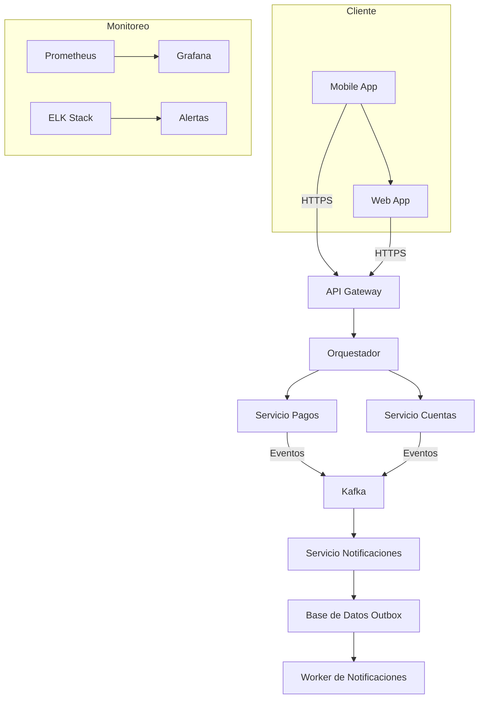

# Prompt para Mejorar el Codigo Base

Copia y pega el contenido del bloque de abajo en un asistente de IA (Claude, ChatGPT)
para obtener un ZIP con el proyecto completo y arrancable.

Si preferis trabajar en tu editor con un agente local (Claude Code, Cursor, Copilot), usa `AGENTS.md` en vez de este archivo: dice lo mismo pero para que escriba los archivos en disco.

## Las dos reglas que no se negocian

1. **Completa el boilerplate.** Todo lo que el proyecto necesita para compilar y arrancar: manifiesto de dependencias, punto de entrada, configuracion, capa de interfaz, y las capas del patron arquitectonico declarado. Eso es andamiaje y es tu trabajo.
2. **NO resuelvas el reto.** Los entregables de las fases son el trabajo de la persona. El hueco pedagogico se deja como esta: el proyecto arranca, pero lo que el reto pide implementar NO esta implementado.

Dicho de otra forma: si algo impide compilar, arreglalo. Si algo es logica de negocio incompleta, validaciones ausentes, un secreto hardcodeado o un patron mejorable, dejalo exactamente como esta — es lo que la persona tiene que encontrar.

## Superficie de practica — NO resuelvas

Estos archivos SON el ejercicio de la persona. No los implementes; deja stubs.

- `contratos/openapi.yaml` — El topic pide el contrato de API: openapi.yaml es el ejercicio.

## Como saber que terminaste

```bash
npx --yes @redocly/cli lint contratos/openapi.yaml
```

Ese comando corriendo sin errores es la definicion de "listo".

---

```
## Briefing del reto (autoridad)
Este bloque manda sobre los archivos adjuntos. El stack y el rol salen de AQUÍ, no de un topic genérico ni de markdown placeholder.

### Perfil
Chapter Integración, Especialidad Analista SOA, Tecnología SOA, Advanced

### Brecha de conocimiento
Demostrar el uso de patrones de integración aplicados en solución. Aplicación de principios de API o microservicios en la solución. Entregar una solución aplicando patrones.

### Misión / candidato
Candidata con experiencia en análisis y diseño de arquitecturas SOA, trabajando en proyectos de orquestación de servicios.

### Reto
- Tema: diseño de la arquitectura SOA
- Seniority: advanced-l3
- Tipo: practical
- Título: Diseño y aplicación de patrones de integración en una arquitectura SOA
- Tiempo estimado: 8 horas

### Fases (trabajo del HUMANO — PROHIBIDO completarlas)
No implementes estos entregables. Dejalos como hueco pedagógico. El asistente solo materializa el proyecto arrancable para que el participante pueda trabajar.
- Fase 1: Identificación de las necesidades de integración — objetivo: Identificar los puntos de integración necesarios entre los servicios y los patrones de integración adecuados. — entregable (NO resolver): Lista de puntos de integración y patrones de integración propuestos.
- Fase 2: Diseño de la arquitectura SOA con patrones de integración — objetivo: Diseñar la arquitectura SOA aplicando los patrones de integración identificados en la fase anterior. — entregable (NO resolver): Diagrama de la arquitectura SOA con los patrones de integración aplicados.
- Fase 3: Evaluación y optimización de la arquitectura SOA — objetivo: Evaluar y optimizar la arquitectura SOA diseñada en la fase anterior. — entregable (NO resolver): Informe de evaluación y optimización de la arquitectura SOA.

Eres un asistente experto en análisis, corrección y generación de archivos de cualquier tipo:
código fuente, documentación, hojas de cálculo, documentos Word, configuraciones, entre otros.
Voy a enviarte una cadena de texto que contiene uno o más archivos. Cada archivo está delimitado por un marcador con el siguiente formato:
// === ARCHIVO: ruta/del/archivo.extension ===
o también puede aparecer como:
## === ARCHIVO: ruta/del/archivo.extension ===
Lo que sigue al marcador puede ser:

El contenido real del archivo (código, texto, YAML, etc.)
Una descripción en lenguaje natural de lo que debe contener el archivo


TU TAREA
PASO 0 — ¿Esto es un proyecto o una carcasa?
Antes de extraer archivos, leé el Briefing (si está) y diagnosticá el adjunto.

Es CARCASA si ocurre CUALQUIERA de estas:
- No hay manifiesto de dependencias del stack del briefing (manifest.json de VTEX IO / package.json / pom.xml / build.gradle / requirements.txt / go.mod / *.tf / *.csproj, según corresponda)
- Hay un "binario" que en realidad es un comentario ("no puede ser mostrado como texto plano", placeholder .fig/.docx vacío)
- Los markdowns ya completan entregables de fases posteriores ("se implementó fade-in", lista de áreas ya resuelta)

Si es CARCASA:
- MATERIALIZÁ un proyecto que arranca en el stack del briefing (VTEX IO Store Framework, Angular, Terraform, pytest, Nest, etc.). Incluí manifiesto, punto de entrada y capa de interfaz reales.
- NO copies los markdowns de "solución" como si fueran el producto. Son ruido de generación.
- NO resuelvas las fases del briefing (están marcadas PROHIBIDO). Dejá el hueco pedagógico: el flujo existe, las microinteracciones/calidad/infra que el reto pide NO están hechas.
- Después seguí al PASO 5 (ZIP).

Si es un proyecto REAL (manifiesto + código que compila o arranca):
- Seguí PASO 1 en adelante. 🔴 compilación sí. 🟡 pedagógico no.

PASO 1 — Detección y extracción
Identifica todos los archivos presentes en la cadena. Para cada archivo extrae:

Su ruta completa (ej: src/main/java/com/pragma/Service.java)
Su contenido o descripción

PASO 2 — Clasificación por tipo
Clasifica cada archivo en una de estas categorías:
A) Código fuente (Java, Python, TypeScript, JavaScript, Kotlin, etc.)
B) Configuración / documentación (YAML, properties, Markdown, JSON, txt, etc.)
C) Excel (.xlsx, .xls, .csv)
D) Word (.docx, .doc)
E) Otro tipo de archivo binario o especial
PASO 3 — Clasificación de errores en código fuente

Objetivo prioritario: que el proyecto compile. No corrijas flujo de negocio ni lógica funcional.

Antes de modificar cualquier archivo de código fuente, clasifica cada problema encontrado en una de estas dos categorías:
🔴 ERROR DE COMPILACIÓN — corregir siempre
Son errores que impiden que el proyecto arranque, sin valor pedagógico:

Import faltante o incorrecto
Clase, método o variable referenciada que no existe en ningún archivo del proyecto
Error de sintaxis
Anotación con atributos inválidos
Dependencia ausente en pom.xml, package.json, etc.
Archivo referenciado que no existe y debe ser creado con implementación mínima

→ CORREGIR estos errores.
🟡 PROBLEMA FUNCIONAL O DE CALIDAD — preservar siempre
Son problemas que no impiden compilar. Pueden ser intencionales para el aprendizaje:

Clave secreta hardcodeada ("secret", "password123")
API deprecada que funciona pero tiene reemplazo moderno
Lógica de negocio incorrecta o incompleta
Código redundante o de baja legibilidad
Falta de validaciones en flujo de negocio
Patrones de diseño incorrectos pero funcionales
Concurrencia no segura
Configuración funcional pero no óptima

→ PRESERVAR tal cual. No corregir, no mejorar, no comentar.
PASO 4 — Procesamiento según tipo de archivo
Tipo A — Código fuente
Aplica únicamente las correcciones clasificadas como 🔴 ERROR DE COMPILACIÓN.
No alteres ningún elemento clasificado como 🟡 PROBLEMA FUNCIONAL O DE CALIDAD.
Si falta un archivo referenciado, créalo con la implementación mínima necesaria para compilar.
Tipo B — Configuración / documentación
Extrae el contenido tal cual, sin modificaciones salvo errores evidentes de sintaxis
(ej: YAML mal indentado).
Tipo C — Excel (.xlsx)
Si viene con contenido real, genera el archivo respetando ese contenido.
Si viene con descripción en lenguaje natural, genera un archivo Excel funcional con:

Fila de encabezados en negrita con color de fondo distintivo
Columnas con ancho ajustado al contenido
Tipos de dato correctos por columna
Validaciones si la descripción lo indica
Hojas nombradas descriptivamente si hay más de una
Filas de ejemplo si no hay datos reales

Tipo D — Word (.docx)
Si viene con contenido real, genera el archivo respetando ese contenido.
Si viene con descripción en lenguaje natural, genera un documento Word funcional con:

Estilos de título (Título 1, Título 2) para jerarquía de secciones
Fuente legible (Calibri o equivalente), tamaño 11-12pt para cuerpo
Márgenes estándar
Tabla de contenido si tiene múltiples secciones
Tablas con encabezados en negrita si aplica

Tipo E — Otro
Genera el archivo con el contenido o estructura más apropiada según la descripción.
PASO 5 — Exportación en ZIP
Empaqueta todos los archivos en un único archivo ZIP descargable respetando exactamente
la estructura de rutas indicada por los marcadores.
El ZIP debe incluir:

Archivos de código con únicamente los errores de compilación corregidos
Archivos de configuración y documentación sin cambios
Archivos nuevos creados para resolver dependencias de compilación faltantes
Archivos Excel y Word generados desde descripción

IMPORTANTE: El ZIP debe estar listo para descargar al finalizar. No preguntes si el usuario
quiere generarlo. Simplemente genera el archivo y proporciona el enlace de descarga; No debes desplegar en el chat el resumen de lo que arreglaste al Zip, solo entregalo.

REGLAS IMPORTANTES

No omitas ningún archivo aunque no tenga errores ni modificaciones
Respeta los nombres y rutas exactas indicadas por los marcadores
Si un archivo no tiene marcador claro, infiere el nombre desde su contenido
Si la cadena contiene solo documentación, placeholders o binarios fake, NO la reproduzcas:
aplicá PASO 0 (materializar el proyecto del briefing). Reproducir la carcasa es un fallo.
No agregues texto después del enlace de descarga del ZIP
No preguntes si el usuario quiere el ZIP: simplemente generalo siempre
Si detectas que falta un archivo de configuración necesario para compilar
(pom.xml, package.json, requirements.txt, build.gradle, etc.), créalo e inclúyelo
inferiendo su contenido desde los imports y frameworks detectados en el código
Nunca corrijas problemas 🟡 aunque parezcan obvios o fáciles de mejorar.
El participante que recibirá este proyecto los debe encontrar y resolver él mismo.


INPUT
Aquí está la cadena con los archivos:

// === ARCHIVO: contratos/openapi.yaml ===
openapi: 3.1.0
info:
  title: Fintech SOA Integration API
  description: |-
    API para la integración de servicios en arquitectura SOA de una fintech.
    Incluye gestión de cuentas, procesamiento de pagos y notificación de eventos.
    Diseñada bajo estándares OpenAPI 3.1 y alineada con BIAN Service Landscape.
  version: 1.0.0
  contact:
    name: Equipo de Arquitectura SOA
    email: arquitectura@fintech.example.com
  license:
    name: Propietario
    url: https://fintech.example.com/licencia
servers:
  - url: https://api.fintech.example.com/v1
    description: Producción
  - url: https://sandbox.api.fintech.example.com/v1
    description: Sandbox para desarrollo
paths:
  /accounts:
    post:
      tags: [Accounts]
      summary: Crear una nueva cuenta
      description: |-
        Crea una nueva cuenta financiera en el servicio de gestión de cuentas.
        Requiere validación previa de identidad del cliente.
      operationId: createAccount
      requestBody:
        required: true
        content:
          application/json:
            schema:
              $ref: '#/components/schemas/AccountCreationRequest'
            examples:
              valid_request:
                value:
                  customerId: "cust-12345"
                  accountType: "SAVINGS"
                  initialBalance: 1000.00
                  currency: "USD"
      responses:
        "201":
          description: Cuenta creada exitosamente
          content:
            application/json:
              schema:
                $ref: '#/components/schemas/AccountResponse'
              examples:
                created_account:
                  value:
                    accountId: "acc-67890"
                    customerId: "cust-12345"
                    accountType: "SAVINGS"
                    balance: 1000.00
                    currency: "USD"
                    status: "ACTIVE"
                    createdAt: "2023-10-01T10:00:00Z"
        "400":
          description: Solicitud inválida
          content:
            application/json:
              schema:
                $ref: '#/components/schemas/ErrorResponse'
              examples:
                invalid_customer:
                  value:
                    error:
                      code: "INVALID_CUSTOMER"
                      message: "El customerId proporcionado no existe"
                      details:
                        customerId: "cust-12345"
        "409":
          description: Conflicto de datos
          content:
            application/json:
              schema:
                $ref: '#/components/schemas/ErrorResponse'
              examples:
                account_exists:
                  value:
                    error:
                      code: "ACCOUNT_ALREADY_EXISTS"
                      message: "Ya existe una cuenta para este cliente con el mismo tipo"
                      details:
                        customerId: "cust-12345"
                        accountType: "SAVINGS"
        "500":
          description: Error interno del servidor
          content:
            application/json:
              schema:
                $ref: '#/components/schemas/ErrorResponse'
              examples:
                server_error:
                  value:
                    error:
                      code: "INTERNAL_ERROR"
                      message: "Error inesperado al procesar la solicitud"
                      details:
                        timestamp: "2023-10-01T10:00:00Z"
    get:
      tags: [Accounts]
      summary: Consultar cuentas de un cliente
      description: |-
        Retorna todas las cuentas activas de un cliente específico.
        Puede filtrarse por tipo de cuenta y estado.
      operationId: getCustomerAccounts
      parameters:
        - $ref: '#/components/parameters/customerId'
        - $ref: '#/components/parameters/accountType'
        - $ref: '#/components/parameters/accountStatus'
      responses:
        "200":
          description: Lista de cuentas del cliente
          content:
            application/json:
              schema:
                type: array
                items:
                  $ref: '#/components/schemas/AccountResponse'
              examples:
                customer_accounts:
                  value:
                    - accountId: "acc-67890"
                      customerId: "cust-12345"
                      accountType: "SAVINGS"
                      balance: 1000.00
                      currency: "USD"
                      status: "ACTIVE"
                      createdAt: "2023-10-01T10:00:00Z"
                    - accountId: "acc-54321"
                      customerId: "cust-12345"
                      accountType: "CHECKING"
                      balance: 500.00
                      currency: "USD"
                      status: "ACTIVE"
                      createdAt: "2023-09-15T09:30:00Z"
        "400":
          description: Parámetros inválidos
          content:
            application/json:
              schema:
                $ref: '#/components/schemas/ErrorResponse'
              examples:
                invalid_customer_id:
                  value:
                    error:
                      code: "INVALID_PARAMETER"
                      message: "El customerId debe ser un UUID válido"
                      details:
                        parameter: "customerId"
                        value: "invalid-id"
        "500":
          description: Error interno del servidor
          content:
            application/json:
              schema:
                $ref: '#/components/schemas/ErrorResponse'

  /payments:
    post:
      tags: [Payments]
      summary: Iniciar un pago
      description: |-
        Inicia el procesamiento de un pago entre cuentas o hacia terceros.
        Requiere validación de fondos y cumplimiento de regulaciones.
      operationId: initiatePayment
      requestBody:
        required: true
        content:
          application/json:
            schema:
              $ref: '#/components/schemas/PaymentRequest'
            examples:
              valid_payment:
                value:
                  sourceAccountId: "acc-67890"
                  destinationAccountId: "acc-54321"
                  amount: 200.00
                  currency: "USD"
                  description: "Transferencia entre cuentas"
                  paymentType: "INTERNAL"
      responses:
        "202":
          description: Pago aceptado para procesamiento
          content:
            application/json:
              schema:
                $ref: '#/components/schemas/PaymentResponse'
              examples:
                payment_accepted:
                  value:
                    paymentId: "pay-12345"
                    status: "PROCESSING"
                    createdAt: "2023-10-01T11:00:00Z"
        "400":
          description: Solicitud inválida
          content:
            application/json:
              schema:
                $ref: '#/components/schemas/ErrorResponse'
              examples:
                insufficient_funds:
                  value:
                    error:
                      code: "INSUFFICIENT_FUNDS"
                      message: "Fondos insuficientes en la cuenta origen"
                      details:
                        sourceAccountId: "acc-67890"
                        availableBalance: 100.00
                        requestedAmount: 200.00
        "402":
          description: Pago requerido (límites excedidos)
          content:
            application/json:
              schema:
                $ref: '#/components/schemas/ErrorResponse'
              examples:
                limit_exceeded:
                  value:
                    error:
                      code: "PAYMENT_LIMIT_EXCEEDED"
                      message: "Límite diario de pagos excedido"
                      details:
                        limit: 1000.00
                        currency: "USD"
        "409":
          description: Conflicto de estado
          content:
            application/json:
              schema:
                $ref: '#/components/schemas/ErrorResponse'
              examples:
                account_inactive:
                  value:
                    error:
                      code: "ACCOUNT_INACTIVE"
                      message: "La cuenta origen está inactiva"
                      details:
                        accountId: "acc-67890"
                        status: "FROZEN"
        "500":
          description: Error interno del servidor
          content:
            application/json:
              schema:
                $ref: '#/components/schemas/ErrorResponse'

  /payments/{paymentId}:
    get:
      tags: [Payments]
      summary: Consultar estado de un pago
      description: Retorna el estado actual de un pago específico.
      operationId: getPaymentStatus
      parameters:
        - $ref: '#/components/parameters/paymentId'
      responses:
        "200":
          description: Estado del pago
          content:
            application/json:
              schema:
                $ref: '#/components/schemas/PaymentResponse'
              examples:
                completed_payment:
                  value:
                    paymentId: "pay-12345"
                    status: "COMPLETED"
                    createdAt: "2023-10-01T11:00:00Z"
                    completedAt: "2023-10-01T11:05:00Z"
        "404":
          description: Pago no encontrado
          content:
            application/json:
              schema:
                $ref: '#/components/schemas/ErrorResponse'
              examples:
                payment_not_found:
                  value:
                    error:
                      code: "PAYMENT_NOT_FOUND"
                      message: "El pago solicitado no existe"
                      details:
                        paymentId: "pay-99999"
        "500":
          description: Error interno del servidor
          content:
            application/json:
              schema:
                $ref: '#/components/schemas/ErrorResponse'

  /events/notifications:
    post:
      tags: [Events]
      summary: Suscribirse a notificaciones de eventos
      description: |-
        Permite suscribir un endpoint para recibir notificaciones de eventos
        relacionados con cuentas y pagos.
      operationId: subscribeToEvents
      requestBody:
        required: true
        content:
          application/json:
            schema:
              $ref: '#/components/schemas/EventSubscriptionRequest'
            examples:
              valid_subscription:
                value:
                  callbackUrl: "https://client.example.com/callback"
                  eventTypes: ["ACCOUNT_CREATED", "PAYMENT_COMPLETED"]
                  secret: "s3cr3t-t0k3n"
      responses:
        "201":
          description: Suscripción creada
          content:
            application/json:
              schema:
                $ref: '#/components/schemas/EventSubscriptionResponse'
              examples:
                subscription_created:
                  value:
                    subscriptionId: "sub-12345"
                    callbackUrl: "https://client.example.com/callback"
                    eventTypes: ["ACCOUNT_CREATED", "PAYMENT_COMPLETED"]
                    status: "ACTIVE"
                    createdAt: "2023-10-01T12:00:00Z"
        "400":
          description: Solicitud inválida
          content:
            application/json:
              schema:
                $ref: '#/components/schemas/ErrorResponse'
              examples:
                invalid_callback_url:
                  value:
                    error:
                      code: "INVALID_CALLBACK_URL"
                      message: "La URL de callback debe ser HTTPS y válida"
                      details:
                        callbackUrl: "http://client.example.com/callback"
        "500":
          description: Error interno del servidor
          content:
            application/json:
              schema:
                $ref: '#/components/schemas/ErrorResponse'

components:
  schemas:
    AccountCreationRequest:
      type: object
      required: [customerId, accountType, initialBalance, currency]
      properties:
        customerId:
          type: string
          format: uuid
          description: Identificador único del cliente
          example: "cust-12345"
        accountType:
          type: string
          enum: [SAVINGS, CHECKING, LOAN, INVESTMENT]
          description: Tipo de cuenta
          example: "SAVINGS"
        initialBalance:
          type: number
          format: double
          minimum: 0
          description: Saldo inicial de la cuenta
          example: 1000.00
        currency:
          type: string
          pattern: "^[A-Z]{3}$"
          description: Código ISO de moneda (ej. USD, EUR)
          example: "USD"
    AccountResponse:
      type: object
      required: [accountId, customerId, accountType, balance, currency, status, createdAt]
      properties:
        accountId:
          type: string
          format: uuid
          description: Identificador único de la cuenta
          example: "acc-67890"
        customerId:
          type: string
          format: uuid
          description: Identificador único del cliente
          example: "cust-12345"
        accountType:
          type: string
          enum: [SAVINGS, CHECKING, LOAN, INVESTMENT]
          description: Tipo de cuenta
          example: "SAVINGS"
        balance:
          type: number
          format: double
          description: Saldo actual de la cuenta
          example: 1000.00
        currency:
          type: string
          pattern: "^[A-Z]{3}$"
          description: Código ISO de moneda
          example: "USD"
        status:
          type: string
          enum: [ACTIVE, FROZEN, CLOSED, PENDING]
          description: Estado de la cuenta
          example: "ACTIVE"
        createdAt:
          type: string
          format: date-time
          description: Fecha y hora de creación de la cuenta
          example: "2023-10-01T10:00:00Z"
    PaymentRequest:
      type: object
      required: [sourceAccountId, amount, currency, paymentType]
      properties:
        sourceAccountId:
          type: string
          format: uuid
          description: Identificador de la cuenta origen
          example: "acc-67890"
        destinationAccountId:
          type: string
          format: uuid
          description: Identificador de la cuenta destino (requerido para pagos internos)
          example: "acc-54321"
        destinationBankCode:
          type: string
          pattern: "^\d{3,10}$"
          description: Código del banco destino (requerido para pagos externos)
          example: "00123456"
        destinationAccountNumber:
          type: string
          pattern: "^\d{5,20}$"
          description: Número de cuenta destino (requerido para pagos externos)
          example: "1234567890"
        amount:
          type: number
          format: double
          minimum: 0.01
          description: Monto del pago
          example: 200.00
        currency:
          type: string
          pattern: "^[A-Z]{3}$"
          description: Código ISO de moneda
          example: "USD"
        description:
          type: string
          maxLength: 255
          description: Descripción del pago
          example: "Transferencia entre cuentas"
        paymentType:
          type: string
          enum: [INTERNAL, EXTERNAL, CARD]
          description: Tipo de pago
          example: "INTERNAL"
        scheduledAt:
          type: string
          format: date-time
          description: Fecha y hora programada para el pago (futura)
          example: "2023-10-02T10:00:00Z"
    PaymentResponse:
      type: object
      required: [paymentId, status, createdAt]
      properties:
        paymentId:
          type: string
          format: uuid
          description: Identificador único del pago
          example: "pay-12345"
        status:
          type: string
          enum: [PROCESSING, COMPLETED, FAILED, REJECTED, CANCELLED]
          description: Estado del pago
          example: "COMPLETED"
        createdAt:
          type: string
          format: date-time
          description: Fecha y hora de creación del pago
          example: "2023-10-01T11:00:00Z"
        completedAt:
          type: string
          format: date-time
          description: Fecha y hora de finalización del pago (si aplica)
          example: "2023-10-01T11:05:00Z"
        rejectionReason:
          type: string
          description: Razón de rechazo (si aplica)
          example: "Fondos insuficientes"
    EventSubscriptionRequest:
      type: object
      required: [callbackUrl, eventTypes]
      properties:
        callbackUrl:
          type: string
          format: uri
          description: URL HTTPS donde se enviarán las notificaciones
          example: "https://client.example.com/callback"
        eventTypes:
          type: array
          items:
            type: string
            enum: [ACCOUNT_CREATED, ACCOUNT_UPDATED, ACCOUNT_CLOSED, PAYMENT_CREATED, PAYMENT_COMPLETED, PAYMENT_FAILED]
          description: Tipos de eventos a los que suscribirse
          example: ["ACCOUNT_CREATED", "PAYMENT_COMPLETED"]
        secret:
          type: string
          minLength: 16
          maxLength: 64
          description: Secreto para validar las notificaciones
          example: "s3cr3t-t0k3n"
    EventSubscriptionResponse:
      type: object
      required: [subscriptionId, callbackUrl, eventTypes, status, createdAt]
      properties:
        subscriptionId:
          type: string
          format: uuid
          description: Identificador único de la suscripción
          example: "sub-12345"
        callbackUrl:
          type: string
          format: uri
          description: URL de callback registrada
          example: "https://client.example.com/callback"
        eventTypes:
          type: array
          items:
            type: string
            enum: [ACCOUNT_CREATED, ACCOUNT_UPDATED, ACCOUNT_CLOSED, PAYMENT_CREATED, PAYMENT_COMPLETED, PAYMENT_FAILED]
          description: Tipos de eventos suscritos
          example: ["ACCOUNT_CREATED", "PAYMENT_COMPLETED"]
        status:
          type: string
          enum: [ACTIVE, PAUSED, CANCELLED]
          description: Estado de la suscripción
          example: "ACTIVE"
        createdAt:
          type: string
          format: date-time
          description: Fecha y hora de creación de la suscripción
          example: "2023-10-01T12:00:00Z"
    ErrorResponse:
      type: object
      required: [error]
      properties:
        error:
          type: object
          required: [code, message]
          properties:
            code:
              type: string
              description: Código de error específico
              example: "INSUFFICIENT_FUNDS"
            message:
              type: string
              description: Mensaje descriptivo del error
              example: "Fondos insuficientes en la cuenta origen"
            details:
              type: object
              description: Detalles adicionales del error
              additionalProperties: true
              example:
                sourceAccountId: "acc-67890"
                availableBalance: 100.00
                requestedAmount: 200.00
  parameters:
    customerId:
      name: customerId
      in: query
      description: Identificador único del cliente
      required: true
      schema:
        type: string
        format: uuid
      example: "cust-12345"
    accountType:
      name: accountType
      in: query
      description: Tipo de cuenta
      required: false
      schema:
        type: string
        enum: [SAVINGS, CHECKING, LOAN, INVESTMENT]
      example: "SAVINGS"
    accountStatus:
      name: status
      in: query
      description: Estado de la cuenta
      required: false
      schema:
        type: string
        enum: [ACTIVE, FROZEN, CLOSED, PENDING]
      example: "ACTIVE"
    paymentId:
      name: paymentId
      in: path
      description: Identificador único del pago
      required: true
      schema:
        type: string
        format: uuid
      example: "pay-12345"
  securitySchemes:
    bearerAuth:
      type: http
      scheme: bearer
      bearerFormat: JWT
      description: |-
        Token JWT para autenticación. Debe incluir los scopes requeridos:
        - `accounts:read` para consultar cuentas
        - `accounts:write` para crear cuentas
        - `payments:initiate` para iniciar pagos
        - `payments:read` para consultar pagos
        - `events:subscribe` para suscribirse a notificaciones
security:
  - bearerAuth: []


// === ARCHIVO: contratos/openapi.yaml ===
openapi: 3.1.0
info:
  title: API de Integración SOA - Fintech
  description: |
    Contrato de integración entre los servicios de gestión de cuentas, procesamiento de pagos y notificaciones.
    Aplica patrones de integración para garantizar consistencia y escalabilidad.
  version: 1.0.0
  contact:
    name: Equipo de Arquitectura
    email: arquitectura@fintech.com
servers:
  - url: https://api.fintech.com/v1
    description: Servidor de producción
paths:
  /accounts:
    post:
      tags:
        - Gestión de Cuentas
      summary: Crear una nueva cuenta
      description: Crea una nueva cuenta en el sistema.
      operationId: createAccount
      requestBody:
        required: true
        content:
          application/json:
            schema:
              $ref: '#/components/schemas/AccountRequest'
            examples:
              example1:
                value:
                  customerId: "CUST12345"
                  accountType: "SAVINGS"
                  initialBalance: 1000.00
                  currency: "USD"
      responses:
        '201':
          description: Cuenta creada exitosamente
          content:
            application/json:
              schema:
                $ref: '#/components/schemas/AccountResponse'
              examples:
                example1:
                  value:
                    accountId: "ACC67890"
                    customerId: "CUST12345"
                    accountType: "SAVINGS"
                    balance: 1000.00
                    currency: "USD"
                    status: "ACTIVE"
        '400':
          description: Solicitud inválida
          content:
            application/json:
              schema:
                $ref: '#/components/schemas/Error'
              examples:
                example1:
                  value:
                    code: "INVALID_REQUEST"
                    message: "El tipo de cuenta no es válido."
        '500':
          description: Error interno del servidor
          content:
            application/json:
              schema:
                $ref: '#/components/schemas/Error'
              examples:
                example1:
                  value:
                    code: "INTERNAL_ERROR"
                    message: "Ocurrió un error inesperado."

  /accounts/{accountId}:
    get:
      tags:
        - Gestión de Cuentas
      summary: Obtener detalles de una cuenta
      description: Retorna los detalles de una cuenta específica.
      operationId: getAccount
      parameters:
        - name: accountId
          in: path
          required: true
          schema:
            type: string
          examples:
            example1:
              value: "ACC67890"
      responses:
        '200':
          description: Detalles de la cuenta
          content:
            application/json:
              schema:
                $ref: '#/components/schemas/AccountResponse'
              examples:
                example1:
                  value:
                    accountId: "ACC67890"
                    customerId: "CUST12345"
                    accountType: "SAVINGS"
                    balance: 1000.00
                    currency: "USD"
                    status: "ACTIVE"
        '404':
          description: Cuenta no encontrada
          content:
            application/json:
              schema:
                $ref: '#/components/schemas/Error'
              examples:
                example1:
                  value:
                    code: "ACCOUNT_NOT_FOUND"
                    message: "La cuenta no existe."
        '500':
          description: Error interno del servidor
          content:
            application/json:
              schema:
                $ref: '#/components/schemas/Error'

  /payments:
    post:
      tags:
        - Procesamiento de Pagos
      summary: Procesar un pago
      description: Procesa un pago entre cuentas.
      operationId: processPayment
      requestBody:
        required: true
        content:
          application/json:
            schema:
              $ref: '#/components/schemas/PaymentRequest'
            examples:
              example1:
                value:
                  sourceAccountId: "ACC67890"
                  targetAccountId: "ACC54321"
                  amount: 500.00
                  currency: "USD"
                  description: "Transferencia entre cuentas"
      responses:
        '200':
          description: Pago procesado exitosamente
          content:
            application/json:
              schema:
                $ref: '#/components/schemas/PaymentResponse'
              examples:
                example1:
                  value:
                    paymentId: "PAY12345"
                    status: "COMPLETED"
                    sourceAccountId: "ACC67890"
                    targetAccountId: "ACC54321"
                    amount: 500.00
                    currency: "USD"
        '400':
          description: Solicitud inválida
          content:
            application/json:
              schema:
                $ref: '#/components/schemas/Error'
              examples:
                example1:
                  value:
                    code: "INVALID_AMOUNT"
                    message: "El monto debe ser mayor que cero."
        '404':
          description: Cuenta no encontrada
          content:
            application/json:
              schema:
                $ref: '#/components/schemas/Error'
              examples:
                example1:
                  value:
                    code: "ACCOUNT_NOT_FOUND"
                    message: "La cuenta origen o destino no existe."
        '500':
          description: Error interno del servidor
          content:
            application/json:
              schema:
                $ref: '#/components/schemas/Error'

  /notifications:
    post:
      tags:
        - Notificaciones
      summary: Enviar una notificación
      description: Envía una notificación a un cliente.
      operationId: sendNotification
      requestBody:
        required: true
        content:
          application/json:
            schema:
              $ref: '#/components/schemas/NotificationRequest'
            examples:
              example1:
                value:
                  customerId: "CUST12345"
                  message: "Su pago de $500.00 ha sido procesado."
                  channel: "EMAIL"
      responses:
        '200':
          description: Notificación enviada exitosamente
          content:
            application/json:
              schema:
                $ref: '#/components/schemas/NotificationResponse'
              examples:
                example1:
                  value:
                    notificationId: "NOTIF7890"
                    status: "SENT"
        '400':
          description: Solicitud inválida
          content:
            application/json:
              schema:
                $ref: '#/components/schemas/Error'
              examples:
                example1:
                  value:
                    code: "INVALID_CHANNEL"
                    message: "El canal de notificación no es válido."
        '500':
          description: Error interno del servidor
          content:
            application/json:
              schema:
                $ref: '#/components/schemas/Error'

components:
  schemas:
    AccountRequest:
      type: object
      properties:
        customerId:
          type: string
          description: Identificador del cliente.
        accountType:
          type: string
          enum: ["SAVINGS", "CHECKING", "LOAN"]
          description: Tipo de cuenta.
        initialBalance:
          type: number
          format: double
          description: Saldo inicial de la cuenta.
        currency:
          type: string
          description: Moneda de la cuenta.
      required:
        - customerId
        - accountType
        - initialBalance
        - currency

    AccountResponse:
      type: object
      properties:
        accountId:
          type: string
          description: Identificador único de la cuenta.
        customerId:
          type: string
          description: Identificador del cliente.
        accountType:
          type: string
          enum: ["SAVINGS", "CHECKING", "LOAN"]
          description: Tipo de cuenta.
        balance:
          type: number
          format: double
          description: Saldo actual de la cuenta.
        currency:
          type: string
          description: Moneda de la cuenta.
        status:
          type: string
          enum: ["ACTIVE", "INACTIVE", "SUSPENDED"]
          description: Estado de la cuenta.
      required:
        - accountId
        - customerId
        - accountType
        - balance
        - currency
        - status

    PaymentRequest:
      type: object
      properties:
        sourceAccountId:
          type: string
          description: Identificador de la cuenta origen.
        targetAccountId:
          type: string
          description: Identificador de la cuenta destino.
        amount:
          type: number
          format: double
          description: Monto del pago.
        currency:
          type: string
          description: Moneda del pago.
        description:
          type: string
          description: Descripción del pago.
      required:
        - sourceAccountId
        - targetAccountId
        - amount
        - currency

    PaymentResponse:
      type: object
      properties:
        paymentId:
          type: string
          description: Identificador único del pago.
        status:
          type: string
          enum: ["PENDING", "COMPLETED", "FAILED"]
          description: Estado del pago.
        sourceAccountId:
          type: string
          description: Identificador de la cuenta origen.
        targetAccountId:
          type: string
          description: Identificador de la cuenta destino.
        amount:
          type: number
          format: double
          description: Monto del pago.
        currency:
          type: string
          description: Moneda del pago.
      required:
        - paymentId
        - status
        - sourceAccountId
        - targetAccountId
        - amount
        - currency

    NotificationRequest:
      type: object
      properties:
        customerId:
          type: string
          description: Identificador del cliente.
        message:
          type: string
          description: Mensaje de la notificación.
        channel:
          type: string
          enum: ["EMAIL", "SMS", "PUSH"]
          description: Canal de notificación.
      required:
        - customerId
        - message
        - channel

    NotificationResponse:
      type: object
      properties:
        notificationId:
          type: string
          description: Identificador único de la notificación.
        status:
          type: string
          enum: ["SENT", "FAILED"]
          description: Estado de la notificación.
      required:
        - notificationId
        - status

    Error:
      type: object
      properties:
        code:
          type: string
          description: Código de error.
        message:
          type: string
          description: Mensaje de error descriptivo.
      required:
        - code
        - message

// === ARCHIVO: flujos/proceso.bpmn.md ===
# Flujo de Negocio - Integración SOA

## Descripción
Este documento describe el flujo de negocio para la integración entre los servicios de gestión de cuentas, procesamiento de pagos y notificaciones, utilizando notación BPMN 2.0. Se aplican patrones de integración como orquestación y eventos de mensaje para garantizar consistencia y escalabilidad.

## Diagrama BPMN

```bpmn
<?xml version="1.0" encoding="UTF-8"?>
<bpmn:definitions xmlns:bpmn="http://www.omg.org/spec/BPMN/20100524/MODEL"
                  xmlns:bpmndi="http://www.omg.org/spec/BPMN/20100524/DI"
                  xmlns:dc="http://www.omg.org/spec/DD/20100524/DC"
                  xmlns:di="http://www.omg.org/spec/DD/20100524/DI"
                  id="Definitions_1"
                  targetNamespace="http://bpmn.io/schema/bpmn">
  <bpmn:process id="Process_1" isExecutable="false">
    <bpmn:startEvent id="StartEvent_1" name="Inicio">
      <bpmn:outgoing>Flow_1</bpmn:outgoing>
    </bpmn:startEvent>
    <bpmn:sequenceFlow id="Flow_1" sourceRef="StartEvent_1" targetRef="Task_1" />
    <bpmn:task id="Task_1" name="Crear Cuenta">
      <bpmn:incoming>Flow_1</bpmn:incoming>
      <bpmn:outgoing>Flow_2</bpmn:outgoing>
    </bpmn:task>
    <bpmn:sequenceFlow id="Flow_2" sourceRef="Task_1" targetRef="Gateway_1" />
    <bpmn:exclusiveGateway id="Gateway_1" name="¿Cuenta creada?">
      <bpmn:incoming>Flow_2</bpmn:incoming>
      <bpmn:outgoing>Flow_3</bpmn:outgoing>
      <bpmn:outgoing>Flow_4</bpmn:outgoing>
    </bpmn:exclusiveGateway>
    <bpmn:sequenceFlow id="Flow_3" sourceRef="Gateway_1" targetRef="Task_2" name="Sí">
      <bpmn:conditionExpression xsi:type="bpmn:tFormalExpression">${cuentaCreada == true}</bpmn:conditionExpression>
    </bpmn:sequenceFlow>
    <bpmn:sequenceFlow id="Flow_4" sourceRef="Gateway_1" targetRef="EndEvent_1" name="No">
      <bpmn:conditionExpression xsi:type="bpmn:tFormalExpression">${cuentaCreada == false}</bpmn:conditionExpression>
    </bpmn:sequenceFlow>
    <bpmn:task id="Task_2" name="Procesar Pago">
      <bpmn:incoming>Flow_3</bpmn:incoming>
      <bpmn:outgoing>Flow_5</bpmn:outgoing>
    </bpmn:task>
    <bpmn:sequenceFlow id="Flow_5" sourceRef="Task_2" targetRef="Gateway_2" />
    <bpmn:exclusiveGateway id="Gateway_2" name="¿Pago exitoso?">
      <bpmn:incoming>Flow_5</bpmn:incoming>
      <bpmn:outgoing>Flow_6</bpmn:outgoing>
      <bpmn:outgoing>Flow_7</bpmn:outgoing>
    </bpmn:exclusiveGateway>
    <bpmn:sequenceFlow id="Flow_6" sourceRef="Gateway_2" targetRef="Task_3" name="Sí">
      <bpmn:conditionExpression xsi:type="bpmn:tFormalExpression">${pagoExitoso == true}</bpmn:conditionExpression>
    </bpmn:sequenceFlow>
    <bpmn:sequenceFlow id="Flow_7" sourceRef="Gateway_2" targetRef="EndEvent_1" name="No">
      <bpmn:conditionExpression xsi:type="bpmn:tFormalExpression">${pagoExitoso == false}</bpmn:conditionExpression>
    </bpmn:sequenceFlow>
    <bpmn:task id="Task_3" name="Enviar Notificación">
      <bpmn:incoming>Flow_6</bpmn:incoming>
      <bpmn:outgoing>Flow_8</bpmn:outgoing>
    </bpmn:task>
    <bpmn:sequenceFlow id="Flow_8" sourceRef="Task_3" targetRef="EndEvent_1" />
    <bpmn:endEvent id="EndEvent_1" name="Fin">
      <bpmn:incoming>Flow_4</bpmn:incoming>
      <bpmn:incoming>Flow_8</bpmn:incoming>
    </bpmn:endEvent>
  </bpmn:process>
  <bpmndi:BPMNDiagram id="BPMNDiagram_1">
    <bpmndi:BPMNPlane id="BPMNPlane_1" bpmnElement="Process_1">
      <bpmndi:BPMNShape id="_BPMNShape_StartEvent_2" bpmnElement="StartEvent_1">
        <dc:Bounds x="100" y="100" width="36" height="36" />
      </bpmndi:BPMNShape>
      <bpmndi:BPMNShape id="Task_1_di" bpmnElement="Task_1">
        <dc:Bounds x="200" y="100" width="100" height="80" />
      </bpmndi:BPMNShape>
      <bpmndi:BPMNShape id="Gateway_1_di" bpmnElement="Gateway_1">
        <dc:Bounds x="350" y="100" width="50" height="50" />
      </bpmndi:BPMNShape>
      <bpmndi:BPMNShape id="Task_2_di" bpmnElement="Task_2">
        <dc:Bounds x="450" y="100" width="100" height="80" />
      </bpmndi:BPMNShape>
      <bpmndi:BPMNShape id="Gateway_2_di" bpmnElement="Gateway_2">
        <dc:Bounds x="600" y="100" width="50" height="50" />
      </bpmndi:BPMNShape>
      <bpmndi:BPMNShape id="Task_3_di" bpmnElement="Task_3">
        <dc:Bounds x="700" y="100" width="100" height="80" />
      </bpmndi:BPMNShape>
      <bpmndi:BPMNShape id="EndEvent_1_di" bpmnElement="EndEvent_1">
        <dc:Bounds x="850" y="100" width="36" height="36" />
      </bpmndi:BPMNShape>
      <bpmndi:BPMNEdge id="Flow_1_di" bpmnElement="Flow_1">
        <di:waypoint xsi:type="dc:Point" x="136" y="118" />
        <di:waypoint xsi:type="dc:Point" x="200" y="140" />
      </bpmndi:BPMNEdge>
      <bpmndi:BPMNEdge id="Flow_2_di" bpmnElement="Flow_2">
        <di:waypoint xsi:type="dc:Point" x="300" y="140" />
        <di:waypoint xsi:type="dc:Point" x="350" y="125" />
      </bpmndi:BPMNEdge>
      <bpmndi:BPMNEdge id="Flow_3_di" bpmnElement="Flow_3">
        <di:waypoint xsi:type="dc:Point" x="375" y="100" />
        <di:waypoint xsi:type="dc:Point" x="450" y="140" />
      </bpmndi:BPMNEdge>
      <bpmndi:BPMNEdge id="Flow_4_di" bpmnElement="Flow_4">
        <di:waypoint xsi:type="dc:Point" x="375" y="150" />
        <di:waypoint xsi:type="dc:Point" x="850" y="118" />
      </bpmndi:BPMNEdge>
      <bpmndi:BPMNEdge id="Flow_5_di" bpmnElement="Flow_5">
        <di:waypoint xsi:type="dc:Point" x="550" y="140" />
        <di:waypoint xsi:type="dc:Point" x="600" y="125" />
      </bpmndi:BPMNEdge>
      <bpmndi:BPMNEdge id="Flow_6_di" bpmnElement="Flow_6">
        <di:waypoint xsi:type="dc:Point" x="625" y="100" />
        <di:waypoint xsi:type="dc:Point" x="700" y="140" />
      </bpmndi:BPMNEdge>
      <bpmndi:BPMNEdge id="Flow_7_di" bpmnElement="Flow_7">
        <di:waypoint xsi:type="dc:Point" x="625" y="150" />
        <di:waypoint xsi:type="dc:Point" x="850" y="118" />
      </bpmndi:BPMNEdge>
      <bpmndi:BPMNEdge id="Flow_8_di" bpmnElement="Flow_8">
        <di:waypoint xsi:type="dc:Point" x="800" y="140" />
        <di:waypoint xsi:type="dc:Point" x="850" y="118" />
      </bpmndi:BPMNEdge>
    </bpmndi:BPMNPlane>
  </bpmndi:BPMNDiagram>
</bpmn:definitions>
```

## Actores y Servicios
- **Gestión de Cuentas**: Servicio encargado de crear y gestionar cuentas de clientes.
- **Procesamiento de Pagos**: Servicio encargado de procesar pagos entre cuentas.
- **Notificaciones**: Servicio encargado de enviar notificaciones a los clientes.

## Patrones de Integración
- **Orquestación**: El flujo principal es orquestado por un componente central que coordina las llamadas a los servicios.
- **Eventos de Mensaje**: Los servicios emiten eventos para notificar cambios de estado (ej: pago completado).

## Puntos de Decisión
1. **Creación de Cuenta**: ¿La cuenta fue creada exitosamente?
2. **Procesamiento de Pago**: ¿El pago fue procesado exitosamente?

## Transacciones
- La creación de cuenta y el procesamiento de pagos deben ser atómicos para garantizar consistencia.
- Las notificaciones son asíncronas y no bloquean el flujo principal.

// === ARCHIVO: mapeos/mapeo-de-datos.csv ===
origen,destino,tipo,obligatorio,regla_transformacion,ejemplo_origen,ejemplo_destino
customerId,customerId,string,SI,Directo,CUST12345,CUST12345
accountType,accountType,string,SI,Mapeo estático: SAVINGS->AHORROS; CHECKING->CORRIENTE; LOAN->PRESTAMO,SAVINGS,AHORROS
initialBalance,saldo_inicial,number,SI,Directo,1000.00,1000.00
currency,currency,string,SI,Mapeo estático: USD->DOLAR; EUR->EURO; COP->PESO_COLOMBIANO,USD,DOLAR
accountId,id_cuenta,string,SI,Directo,ACC67890,ACC67890
balance,saldo_actual,number,SI,Directo,1000.00,1000.00
status,estado_cuenta,string,SI,Mapeo estático: ACTIVE->ACTIVA; INACTIVE->INACTIVA; SUSPENDED->SUSPENDIDA,ACTIVE,ACTIVA
sourceAccountId,cuenta_origen,string,SI,Directo,ACC67890,ACC67890
targetAccountId,cuenta_destino,string,SI,Directo,ACC54321,ACC54321
amount,monto,number,SI,Directo,500.00,500.00
description,descripcion,string,NO,Directo,"Transferencia entre cuentas","Transferencia entre cuentas"
paymentId,id_pago,string,SI,Directo,PAY12345,PAY12345
paymentStatus,estado_pago,string,SI,Mapeo estático: PENDING->PENDIENTE; COMPLETED->COMPLETADO; FAILED->FALLIDO,COMPLETED,COMPLETADO
message,mensaje,string,SI,Directo,"Su pago de $500.00 ha sido procesado.","Su pago de $500.00 ha sido procesado."
channel,canal,string,SI,Mapeo estático: EMAIL->CORREO; SMS->SMS; PUSH->NOTIFICACION_PUSH,EMAIL,CORREO
notificationId,id_notificacion,string,SI,Directo,NOTIF7890,NOTIF7890
notificationStatus,estado_notificacion,string,SI,Mapeo estático: SENT->ENVIADA; FAILED->FALLIDA,SENT,ENVIADA


// === ARCHIVO: criterios/criterios-de-aceptacion.feature ===
# language: es

Feature: Integración de servicios SOA para procesamiento de pagos y notificaciones
  Como arquitecto de integración
  Quiero asegurar que los servicios de cuentas, pagos y notificaciones interactúen correctamente
  Para garantizar consistencia, escalabilidad y resiliencia en la arquitectura SOA

  Background:
    Given El servicio de gestión de cuentas está disponible
    And El servicio de procesamiento de pagos está disponible
    And El servicio de notificaciones está disponible
    And Se ha definido el siguiente contrato OpenAPI para la integración:
      """
      paths:
        /accounts/{accountId}:
          get:
            summary: Obtener detalles de una cuenta
            responses:
              200:
                description: Detalles de la cuenta
                content:
                  application/json:
                    schema:
                      $ref: '#/components/schemas/Account'
              404:
                description: Cuenta no encontrada
      components:
        schemas:
          Account:
            type: object
            properties:
              id:
                type: string
                format: uuid
              balance:
                type: number
                format: double
              status:
                type: string
                enum: [ACTIVE, BLOCKED, CLOSED]
      """

  Scenario: Procesamiento exitoso de un pago desde una cuenta activa
    Given Una cuenta con ID "123e4567-e89b-12d3-a456-426614174000" y balance de 1000.00 y estado ACTIVE
    When Se recibe una solicitud de pago por 500.00 desde la cuenta "123e4567-e89b-12d3-a456-426614174000"
    Then El sistema debe:
      | servicio_destino          | acción                                      | resultado_esperado                          |
      | Servicio de Cuentas        | Actualizar balance                          | Balance = 500.00                           |
      | Servicio de Pagos          | Registrar transacción                       | Estado = COMPLETED                         |
      | Servicio de Notificaciones  | Enviar notificación al cliente              | Notificación entregada con éxito           |
      | Base de Datos              | Persistir cambios                           | Cambios confirmados                        |

  Scenario: Intento de pago desde una cuenta con fondos insuficientes
    Given Una cuenta con ID "123e4567-e89b-12d3-a456-426614174000" y balance de 200.00 y estado ACTIVE
    When Se recibe una solicitud de pago por 500.00 desde la cuenta "123e4567-e89b-12d3-a456-426614174000"
    Then El sistema debe:
      | servicio_destino          | acción                                      | resultado_esperado                          |
      | Servicio de Cuentas        | Rechazar transacción                       | Balance permanece en 200.00                |
      | Servicio de Pagos          | Registrar transacción fallida               | Estado = REJECTED, motivo = INSUFFICIENT_FUNDS |
      | Servicio de Notificaciones  | Enviar notificación de rechazo al cliente   | Notificación entregada con éxito           |

  Scenario: Intento de pago desde una cuenta bloqueada
    Given Una cuenta con ID "123e4567-e89b-12d3-a456-426614174001" y balance de 1000.00 y estado BLOCKED
    When Se recibe una solicitud de pago por 500.00 desde la cuenta "123e4567-e89b-12d3-a456-426614174001"
    Then El sistema debe:
      | servicio_destino          | acción                                      | resultado_esperado                          |
      | Servicio de Cuentas        | Rechazar transacción                       | Estado de la cuenta permanece BLOCKED       |
      | Servicio de Pagos          | Registrar transacción fallida               | Estado = REJECTED, motivo = ACCOUNT_BLOCKED |
      | Servicio de Notificaciones  | Enviar notificación de rechazo al cliente   | Notificación entregada con éxito           |

  Scenario: Fallo en el servicio de notificaciones durante un pago exitoso
    Given Una cuenta con ID "123e4567-e89b-12d3-a456-426614174000" y balance de 1000.00 y estado ACTIVE
    And El servicio de notificaciones está temporalmente no disponible
    When Se recibe una solicitud de pago por 500.00 desde la cuenta "123e4567-e89b-12d3-a456-426614174000"
    Then El sistema debe:
      | servicio_destino          | acción                                      | resultado_esperado                          |
      | Servicio de Cuentas        | Actualizar balance                          | Balance = 500.00                           |
      | Servicio de Pagos          | Registrar transacción                       | Estado = COMPLETED                         |
      | Servicio de Notificaciones  | Reintentar envío de notificación            | Notificación marcada para reintento        |
      | Sistema de Monitoreo       | Registrar alerta de fallo                   | Alerta generada                            |

  Scenario: Timeout en el servicio de pagos durante el procesamiento
    Given Una cuenta con ID "123e4567-e89b-12d3-a456-426614174000" y balance de 1000.00 y estado ACTIVE
    And El servicio de pagos tarda más de 5 segundos en responder
    When Se recibe una solicitud de pago por 500.00 desde la cuenta "123e4567-e89b-12d3-a456-426614174000"
    Then El sistema debe:
      | servicio_destino          | acción                                      | resultado_esperado                          |
      | Servicio de Cuentas        | Mantener balance sin cambios                | Balance permanece en 1000.00               |
      | Servicio de Pagos          | Registrar intento fallido                   | Estado = PENDING, motivo = TIMEOUT         |
      | Servicio de Notificaciones  | Enviar notificación de retraso al cliente   | Notificación entregada con éxito           |
      | Sistema de Monitoreo       | Registrar alerta de timeout                 | Alerta generada                            |

  Scenario: Inconsistencia temporal entre servicios durante un pago
    Given Una cuenta con ID "123e4567-e89b-12d3-a456-426614174000" y balance de 1000.00 y estado ACTIVE
    And El servicio de pagos confirma la transacción pero el servicio de cuentas falla al actualizar
    When Se recibe una solicitud de pago por 500.00 desde la cuenta "123e4567-e89b-12d3-a456-426614174000"
    Then El sistema debe:
      | servicio_destino          | acción                                      | resultado_esperado                          |
      | Servicio de Cuentas        | Reintentar actualización                    | Balance finalmente actualizado a 500.00    |
      | Servicio de Pagos          | Mantener estado COMPLETED                   | Transacción confirmada                     |
      | Servicio de Notificaciones  | Enviar notificación al cliente              | Notificación entregada con retraso        |
      | Sistema de Monitoreo       | Registrar inconsistencia                    | Alerta generada                            |

// === ARCHIVO: riesgos/analisis-de-riesgo.md ===
# Análisis de Riesgo para la Integración SOA

## Introducción
Este documento identifica los principales modos de falla en la integración de los servicios de cuentas, pagos y notificaciones dentro de la arquitectura SOA propuesta. Para cada riesgo se evalúa su impacto, probabilidad y se proponen estrategias de mitigación utilizando patrones de resiliencia y diseño arquitectónico.

## Metodología
- **Identificación**: Análisis de flujos BPMN y contratos OpenAPI
- **Evaluación**: Matriz de impacto vs probabilidad (escala 1-5)
- **Mitigación**: Patrones de integración y técnicas de resiliencia
- **Responsable**: Equipo de Arquitectura SOA

## Riesgos Identificados

| Modo de Falla                          | Impacto (1-5) | Probabilidad (1-5) | Descripción                                                                                     | Mitigación                                                                                     | Responsable          |
|----------------------------------------|----------------|---------------------|-------------------------------------------------------------------------------------------------|-----------------------------------------------------------------------------------------------|----------------------|
| Timeout en servicio de pagos           | 4              | 3                   | El servicio de pagos no responde dentro del tiempo esperado (5 segundos)                      | - Implementar **Circuit Breaker** (ej: Resilience4j)
- Configurar **Retry Policy** con backoff exponencial
- Usar **Asynchronous Request-Reply** con colas temporales
- Monitorear latencia con **Prometheus/Grafana** | Arquitectura SOA      |
| Fallo en servicio de notificaciones    | 3              | 2                   | El servicio de notificaciones está caído o no puede entregar mensajes                        | - Implementar **Outbox Pattern** para almacenar notificaciones pendientes
- Usar **Dead Letter Queue (DLQ)** para reprocesamiento
- Notificaciones redundantes (email + SMS + push)
- Monitorear disponibilidad del servicio | Operaciones           |
| Inconsistencia de datos                | 5              | 2                   | El servicio de pagos confirma la transacción pero el servicio de cuentas falla al actualizar  | - Implementar **Saga Pattern** para coordinación transaccional
- Usar **Event Sourcing** para reconciliación
- **Two-Phase Commit** (2PC) en casos críticos
- Auditoría con **CDC (Change Data Capture)**        | Arquitectura SOA      |
| Sobrecarga del servicio de cuentas     | 4              | 4                   | Alta demanda simultánea provoca degradación en el servicio de cuentas                         | - Implementar **Rate Limiting** (ej: Token Bucket)
- Usar **Caching** (Redis) para lecturas frecuentes
- **Horizontal Scaling** con Kubernetes
- **Load Balancing** con NGINX             | DevOps                |
| Fallo en la cola de eventos            | 5              | 1                   | La cola de eventos (Kafka/RabbitMQ) se cae y pierde mensajes                                  | - Implementar **Persistencia en disco** para colas
- Usar **Multi-Region Replication** para alta disponibilidad
- **Mirroring** de colas en clusters separados
- Monitorear health checks de la cola     | Infraestructura       |
| Error en transformación de datos       | 3              | 3                   | Los datos entre servicios no se transforman correctamente (ej: formato de moneda)             | - Validación con **JSON Schema** en cada servicio
- Usar **Enterprise Integration Patterns (EIP)** como Normalizer
- Pruebas automáticas con **Pact** para contratos
- Logs detallados de transformaciones     | Desarrollo            |
| Ataque de seguridad (DDoS)             | 5              | 2                   | Ataque de denegación de servicio que satura los endpoints                                     | - Implementar **WAF (Web Application Firewall)**
- Usar **API Gateway** con throttling
- **IP Whitelisting** para servicios internos
- Monitorear tráfico con **SIEM**          | Seguridad             |
| Fallo en el orquestador                | 4              | 2                   | El servicio de orquestación falla y las transacciones quedan en estado inconsistente          | - Implementar **Redundancia activa-activa** para el orquestador
- Usar **Checkpointing** para recuperación
- **Heartbeat** entre servicios
- Monitorear estado del orquestador       | Arquitectura SOA      |

## Patrones de Resiliencia Aplicados

### 1. Circuit Breaker
- **Implementación**: Resilience4j o Hystrix
- **Configuración**:
  ```yaml
  resilience4j:
    circuitbreaker:
      instances:
        paymentService:
          registerHealthIndicator: true
          slidingWindowType: TIME_BASED
          slidingWindowSize: 10
          minimumNumberOfCalls: 5
          permittedNumberOfCallsInHalfOpenState: 3
          automaticTransitionFromOpenToHalfOpenEnabled: true
          waitDurationInOpenState: 5s
          failureRateThreshold: 50
          eventConsumerBufferSize: 10
  ```
- **Servicios aplicables**: Pagos, Notificaciones

### 2. Saga Pattern
- **Flujo de compensación**:
  ```mermaid
  graph TD
    A[Inicio Transacción] --> B[Reservar Fondos]
    B --> C[Procesar Pago]
    C --> D[Enviar Notificación]
    D --> E[Fin Transacción]
    C -- Fallo --> F[Liberar Fondos]
    B -- Fallo --> G[Cancelar Transacción]
  ```
- **Mecanismo**: Orquestador centralizado con pasos compensatorios

### 3. Outbox Pattern
- **Implementación**:
  ```sql
  CREATE TABLE outbox (
    id UUID PRIMARY KEY,
    aggregate_type VARCHAR(255) NOT NULL,
    aggregate_id VARCHAR(255) NOT NULL,
    event_type VARCHAR(255) NOT NULL,
    payload JSONB NOT NULL,
    created_at TIMESTAMP NOT NULL,
    processed_at TIMESTAMP,
    status VARCHAR(20) DEFAULT 'PENDING'
  );
  ```
- **Uso**: Para notificaciones asíncronas

## Métricas de Monitoreo

| Métrica                          | Umbral de Alerta | Herramienta       | Frecuencia |
|----------------------------------|-------------------|-------------------|------------|
| Latencia servicio de pagos      | > 2s             | Prometheus        | Cada 1s    |
| Tasa de errores en notificaciones| > 5%             | Grafana           | Cada 5s    |
| Tamaño cola de eventos          | > 1000 mensajes   | Kafka Manager     | Cada 10s   |
| Disponibilidad servicio cuentas | < 99.9%          | Datadog           | Cada 1m    |
| Tiempo de procesamiento Saga    | > 10s            | ELK Stack         | Por evento |

## Plan de Contingencia

1. **Fallo total del servicio de pagos**:
   - Activar **modo degradado** con procesamiento manual
   - Notificar a clientes con **mensaje estandarizado**
   - Escalar a equipo de operaciones

2. **Pérdida de datos en cola de eventos**:
   - Restaurar desde **backup** (máximo 5 minutos de datos perdidos)
   - Reprocesar transacciones desde **log de auditoría**
   - Notificar a clientes afectados

3. **Ataque DDoS**:
   - Activar **modo solo lectura** temporalmente
   - Bloquear IPs sospechosas
   - Escalar a proveedor de seguridad

## Conclusiones

La arquitectura propuesta mitiga los principales riesgos mediante:
1. **Patrones de resiliencia** (Circuit Breaker, Saga, Outbox)
2. **Monitoreo proactivo** con umbrales de alerta
3. **Plan de contingencia** para fallos catastróficos
4. **Pruebas de caos** para validar la resiliencia (ej: Chaos Monkey)

**Próximos pasos**:
- Implementar pruebas de carga con **Gatling**
- Configurar dashboards de monitoreo en **Grafana**
- Documentar procedimientos de recuperación

// === ARCHIVO: README.md ===
# Arquitectura SOA con Patrones de Integración

## Decisión Arquitectónica: Orquestación vs Coreografía

Se eligió un **modelo híbrido** con **orquestación centralizada** para flujos críticos (pagos) y **coreografía** para eventos no críticos (notificaciones). Esta decisión balancea consistencia y escalabilidad:

### Trade-offs Evaluados

| Criterio               | Orquestación                          | Coreografía                          | Decisión Híbrida                          |
|------------------------|----------------------------------------|---------------------------------------|------------------------------------------|
| **Consistencia**      | Alta (coordinación centralizada)       | Baja (eventos eventuales)            | Alta para pagos, eventual para notificaciones |
| **Escalabilidad**     | Cuello de botella en el orquestador    | Alta (servicios desacoplados)        | Escalable donde importa                   |
| **Complejidad**       | Alta (orquestador como punto único)    | Baja (servicios autónomos)            | Complejidad gestionada                    |
| **Tolerancia a fallos**| Depende del orquestador                | Alta (servicios independientes)       | Tolerancia por diseño                     |
| **Latencia**          | Alta (coordinación secuencial)         | Baja (procesamiento paralelo)         | Latencia optimizada por caso              |

### Justificación

1. **Pagos**: Requieren **coordinación transaccional** entre servicios de cuentas y pagos → **Orquestación** con Saga Pattern
2. **Notificaciones**: Pueden manejarse como eventos asíncronos → **Coreografía** con Outbox Pattern
3. **Escalabilidad**: Los servicios menos críticos (notificaciones) no deben bloquear a los críticos (pagos)

## Patrones de Integración Aplicados

### 1. Saga Pattern (Orquestación)
- **Responsabilidad**: Coordinar transacciones distribuidas entre servicios
- **Implementación**:
  ```mermaid
  sequenceDiagram
    participant Cliente
    participant API_Gateway
    participant Orquestador
    participant Cuentas
    participant Pagos
    participant Notificaciones

    Cliente->>API_Gateway: POST /payments
    API_Gateway->>Orquestador: Iniciar transacción
    Orquestador->>Cuentas: Reservar fondos
    Cuentas-->>Orquestador: Fondos reservados
    Orquestador->>Pagos: Procesar pago
    Pagos-->>Orquestador: Pago completado
    Orquestador->>Cuentas: Confirmar transacción
    Cuentas-->>Orquestador: Transacción confirmada
    Orquestador->>Notificaciones: Enviar notificación
    Notificaciones-->>Orquestador: Notificación entregada
    Orquestador-->>API_Gateway: Transacción exitosa
    API_Gateway-->>Cliente: 200 OK
  ```
- **Flujo de compensación**: Si cualquier paso falla, el orquestador ejecuta acciones compensatorias (ej: liberar fondos reservados)

### 2. Outbox Pattern (Coreografía)
- **Responsabilidad**: Garantizar la entrega de notificaciones incluso si el servicio está caído
- **Implementación**:
  ```mermaid
  graph LR
    A[Servicio de Pagos] -->|Publica evento| B[Cola de Eventos]
    B --> C[Servicio de Notificaciones]
    C --> D[Base de Datos Outbox]
    D -->|Polling| E[Worker de Notificaciones]
    E --> F[API de Notificaciones]
    F -->|Éxito| G[Actualiza Outbox]
    F -->|Fallo| H[Dead Letter Queue]
  ```

### 3. Circuit Breaker
- **Responsabilidad**: Prevenir cascadas de fallos en servicios dependientes
- **Configuración típica**:
  ```yaml
  circuitBreaker:
    failureRateThreshold: 50
    waitDurationInOpenState: 30s
    permittedNumberOfCallsInHalfOpenState: 10
    slidingWindowSize: 20
    minimumNumberOfCalls: 5
  ```

## Contratos de Integración

### OpenAPI 3.1
- **Ubicación**: `contratos/openapi.yaml`
- **Principales endpoints**:
  - `GET /accounts/{accountId}`: Obtener detalles de cuenta
  - `POST /payments`: Iniciar transacción de pago
  - `GET /payments/{paymentId}`: Consultar estado de pago
- **Schemas reutilizables**:
  - `Account`: Detalles de cuenta (id, balance, status)
  - `Payment`: Datos de pago (id, accountId, amount, status)

### BPMN 2.0
- **Ubicación**: `flujos/proceso.bpmn.md`
- **Procesos modelados**:
  - Procesamiento de pagos
  - Manejo de errores en pagos
  - Notificaciones a clientes

### Mapeo de Datos
- **Ubicación**: `mapeos/mapeo-de-datos.csv`
- **Ejemplo de transformación**:
  ```csv
  origen,campo_origen,tipo_origen,obligatorio_origen,destino,campo_destino,tipo_destino,obligatorio_destino,regla_transformacion
  ServicioCuentas,accountId,UUID,true,ServicioPagos,sourceAccountId,UUID,true,COPY
  ServicioCuentas,balance,Double,true,ServicioPagos,amount,Decimal,true,CONVERT_TO_DECIMAL
  ServicioPagos,status,String,true,ServicioNotificaciones,transactionStatus,String,true,MAP_STATUS
  ```

## Tecnologías Clave

| Componente               | Tecnología               | Versión  | Propósito                                                                 |
|--------------------------|--------------------------|----------|---------------------------------------------------------------------------|
| Contratos API            | OpenAPI                  | 3.1.0    | Definición de interfaces entre servicios                                 |
| Orquestación             | Camunda / Zeebe          | 8.x      | Motor de workflows para Saga Pattern                                      |
| Cola de Eventos          | Apache Kafka             | 3.4.0    | Coreografía de eventos                                                    |
| Circuit Breaker          | Resilience4j             | 2.1.0    | Tolerancia a fallos                                                       |
| Base de Datos            | PostgreSQL               | 15.x     | Almacenamiento transaccional y Outbox Pattern                             |
| Monitoreo                | Prometheus + Grafana     | 2.47 / 10| Métricas y alertas                                                        |
| API Gateway              | Kong / Spring Cloud Gateway | 3.4    | Enrutamiento y seguridad                                                  |

## Pruebas de Integración

### Estrategia
- **Pruebas de contrato**: Validar que los servicios cumplen con OpenAPI usando **Pact**
- **Pruebas de flujo**: Ejecutar escenarios completos de Gherkin con **Cucumber**
- **Pruebas de resiliencia**: Inyectar fallos con **Chaos Mesh**
- **Pruebas de carga**: Simular tráfico con **Gatling**

### Ejemplo de Prueba de Contrato (Pact)
```json
{
  "consumer": {
    "name": "ServicioPagos"
  },
  "provider": {
    "name": "ServicioCuentas"
  },
  "interactions": [
    {
      "description": "Obtener detalles de cuenta",
      "request": {
        "method": "GET",
        "path": "/accounts/123e4567-e89b-12d3-a456-426614174000"
      },
      "response": {
        "status": 200,
        "body": {
          "id": "123e4567-e89b-12d3-a456-426614174000",
          "balance": 1000.00,
          "status": "ACTIVE"
        },
        "headers": {
          "Content-Type": "application/json"
        }
      }
    }
  ]
}
```

## Despliegue y Operaciones

### Arquitectura de Despliegue


### Métricas Críticas

| Métrica                          | Herramienta       | Umbral de Alerta |
|----------------------------------|-------------------|-------------------|
| Tasa de éxito de pagos           | Prometheus        | < 99.9%           |
| Latencia percentil 99           | Grafana           | > 2s              |
| Errores en notificaciones        | ELK Stack         | > 1%              |
| Mensajes en cola (Kafka)         | Kafka Manager     | > 1000            |
| Tiempo de procesamiento Saga     | Camunda           | > 10s             |

## Evolución Futura

1. **Migración a Event-Driven Architecture completa**:
   - Reemplazar orquestación por coreografía completa usando CQRS
   - Implementar **Event Sourcing** para auditoría

2. **Adopción de Service Mesh**:
   - Implementar **Istio** para manejo de tráfico, seguridad y observabilidad
   - Migrar Circuit Breaker a sidecars

3. **Serverless para notificaciones**:
   - Mover servicio de notificaciones a **AWS Lambda**
   - Usar **SQS** para cola de eventos

4. **Multi-Region Deployment**:
   - Desplegar réplicas en múltiples regiones para alta disponibilidad
   - Implementar **Active-Active** para servicios críticos

```
